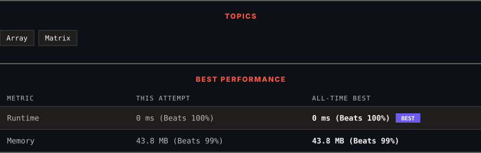

<div align="center">

# 1672. Richest Customer Wealth

      

[](https://leetcode.com/problems/richest-customer-wealth/)

</div>

---

<div align="center">

<picture>
  <source media="(prefers-color-scheme: dark)" srcset="panel-dark.svg">
  <source media="(prefers-color-scheme: light)" srcset="panel-light.svg">
  
</picture>

</div>

> **New personal best** — Runtime improved on this submission.

### HOW IT WENT

| | |
|:--|:--|
| **Attempts** | first try |
| **Time to solve** | 13 min |
| **Verdicts** | ✅ Accepted |

---

### NOTES

_No notes yet._

---

### SOLUTIONS (1)

| # | File | Language | Date |
|:-:|------|:--------:|:----:|
| 1 | [sol1.java](./sol1.java) | `Java` | 2026-10-20 ← **latest** |

---

### PROBLEM DESCRIPTION

You are given an `m x n` integer grid `accounts` where `accounts[i][j]` is the amount of money the `i​​​​​^​​​​​​th​​​​` customer has in the `j​​​​​^​​​​​​th`​​​​ bank. Return* the **wealth** that the richest customer has.*

A customer's **wealth** is the amount of money they have in all their bank accounts. The richest customer is the customer that has the maximum **wealth**.

 

**Example 1:**

```

**Input:** accounts = [[1,2,3],[3,2,1]]
**Output:** 6
**Explanation****:**
`1st customer has wealth = 1 + 2 + 3 = 6
``2nd customer has wealth = 3 + 2 + 1 = 6
`Both customers are considered the richest with a wealth of 6 each, so return 6.

```

**Example 2:**

```

**Input:** accounts = [[1,5],[7,3],[3,5]]
**Output:** 10
**Explanation**: 
1st customer has wealth = 6
2nd customer has wealth = 10 
3rd customer has wealth = 8
The 2nd customer is the richest with a wealth of 10.
```

**Example 3:**

```

**Input:** accounts = [[2,8,7],[7,1,3],[1,9,5]]
**Output:** 17

```

 

**Constraints:**

	- `m == accounts.length`

	- `n == accounts[i].length`

	- `1 <= m, n <= 50`

	- `1 <= accounts[i][j] <= 100`

---

<div align="center">

<sub>Auto-synced by <strong>LeetSync</strong> · Built by <a href="https://deveshsamant.in/">Devesh Samant</a></sub>

</div>
